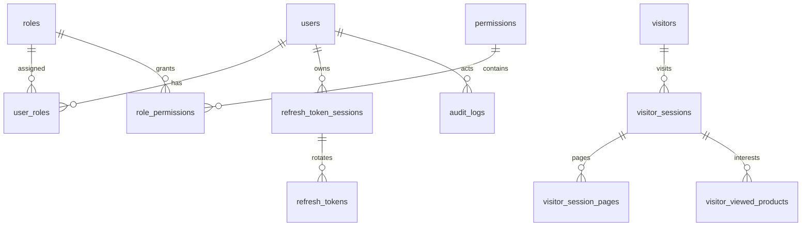

# Admin API và mô hình dữ liệu

Trạng thái ngày04/11/2026: triển khai local trên Node24; bộ backend60 test đã qua MySQL8.4.13 và MariaDB10.11.19. cPanel Edge xác nhận engine hosting10.11.19-MariaDB-cll-lve. Chưa phát hành tính năng này lên production; grants/proxy/backup/restore hosting còn cần kiểm chứng. Xem [vận hành](admin-auth-operations.md) và [build/deploy](build-and-deploy.md).

## Dữ liệu và quyền



`users.is_master` xác định tài khoản quản trị chính duy nhất. Backend từ chối thay đổi thông tin, mật khẩu, trạng thái, xóa hoặc đổi vai trò của tài khoản này, kể cả chính nó. Master vẫn có thể đăng xuất/thu hồi phiên của mình. Mật khẩu bootstrap đọc từ biến môi trường và hash bcrypt cost12; không có mật khẩu mặc định trong mã runtime.

Một user có nhiều role; quyền là hợp của các `resource.action`. Built-in Admin có `full_access`, gồm chức năng bổ sung sau này. User khởi tạo có `customer_access.view`. Không suy ra quyền từ tên role hoặc một `roleId` giả trên frontend. Không cho người có quyền hạn chế cấp quyền vượt quyền của mình hoặc chỉnh role đang cấp quyền cho chính mình. Role Admin không thể đổi/xóa; role User không thể xóa. Đổi quyền role làm mất hiệu lực phiên của mọi account bị ảnh hưởng.

Account bị xóa mềm; username không được tự tái sử dụng. `revision` phục vụ optimistic concurrency: cập nhật bản cũ trả409 và giữ nội dung form để người dùng đối chiếu. Password/status/role thay đổi tăng `auth_version`, thu hồi các phiên cũ; backend kiểm tra lại account/session trên mỗi request.

## Giao thức

API dùng cùng origin `/api`. Request thay đổi dữ liệu cần `Origin` nằm trong allowlist, `Content-Type: application/json`, `X-Bibi-Request: 1`; cookie request cần `credentials: "include"`. API được bảo vệ còn cần `Authorization: Bearer <access_token>`.

JSON thành công là DTO trực tiếp. Danh sách có `{items,total,page,pageSize}`. Không trả password hash, refresh token hoặc identity hash analytics.

Lỗi có dạng:

```json
{"error":{"code":"FORBIDDEN","message":"Không có quyền"},"requestId":"server-generated-id"}
```

400 dữ liệu không hợp lệ;401 chưa đăng nhập/phiên mất hiệu lực;403 thiếu quyền hoặc origin bị chặn;404 không tìm thấy;409 xung đột revision/trạng thái;413 body quá lớn;429 giới hạn request;503 chưa sẵn sàng/lỗi hạ tầng. Body tối đa16KiB. Không trả SQL, stack hoặc credential trong lỗi.

## Authentication

| API | Nội dung |
| --- | --- |
| POST `/api/auth/login` | `{username,password}` → `{accessToken,expiresAt,profile}` và refresh cookie |
| POST `/api/auth/refresh` | `{}`; dùng refresh cookie, rotation và trả grant mới |
| POST `/api/auth/logout` | `{}`; revoke phiên hiện tại, xóa refresh cookie,204 |
| POST `/api/auth/revoke` | `{}` cho phiên hiện tại; `{all:true}` cho tất cả phiên của mình; `{userId,all:true}` cần `account.revoke_session`, không được nhắm Master của người khác |
| GET `/api/auth/profile` | Principal hiện tại gồm danh sách role và permission |

Access JWT HS256 có issuer/audience cố định từ cấu hình, sống15 phút; chỉ nằm trong memory. Refresh cookie host-only, HttpOnly, SameSite=Lax, Path=`/api/auth`, Secure ở production. DB chỉ có SHA256 của refresh token, giữ token đã dùng để phát hiện reuse. Rotation trong transaction; reuse revoke cả session và ghi audit. Idle7 ngày được gia hạn khi hoạt động, tối đa30 ngày từ login.

Nếu response refresh bị mất, frontend không thử lại cùng refresh token vô hạn: lần dùng lại có thể revoke phiên và cần đăng nhập lại. Nhiều401 đồng thời dùng một refresh trong tab, Web Locks tuần tự hóa giữa các tab. Nếu không có Web Locks, reload/expiry yêu cầu login lại. Logout/đổi account hủy hiệu lực các response đang chờ bằng epoch; localStorage chỉ chứa tín hiệu invalidation/opt-out, không chứa token.

## Account, role và audit

| API | Permission |
| --- | --- |
| GET `/api/accounts`, GET `/api/accounts/:id` | `account.view` |
| POST `/api/accounts` | `account.create`; có role cần quyền cấp tương ứng |
| PUT `/api/accounts/:id` | `account.update` |
| DELETE `/api/accounts/:id` | `account.delete` |
| PATCH `/api/accounts/:id/activate` | `account.activate` |
| PATCH `/api/accounts/:id/deactivate` | `account.deactivate` |
| PATCH `/api/accounts/:id/roles` | `account.assign_role` |
| GET `/api/roles`, GET `/api/roles/options` | Quyền xem role/cấp role theo endpoint, options đã lọc grant ceiling |
| POST/PUT/DELETE `/api/roles[/:id]` | `role.create`/`role.update`/`role.delete` |
| GET `/api/permissions` | `permission.view` |
| PATCH `/api/roles/:id/permissions` | `role.assign_permission` |
| GET `/api/audit` | `audit.view` |

Account create: `{username,displayName,email?,password,roleIds?}`. Update: `{revision,username?,displayName?,email?,password?}`. Status/delete: `{revision}`. Roles: `{revision,roleIds}`. Role create có `{name,description?}`; update/delete cần revision; permission update có `{revision,permissionIds}`. Permission ID cũng là code lowercase `resource.action`.

Account/audit list hỗ trợ search, page từ1 và pageSize1–100. API dùng strict input: không nhận cờ nội bộ như `isMaster`/`fullAccess` từ form. Audit ghi login, reuse/revoke và thay đổi account/role/quyền bằng metadata allowlist; không ghi password/token/raw IP.

## Analytics

`POST /api/analytics/collect` nhận `{paths,products,lastPath}`; mỗi mảng tối đa50 phần tử. Chỉ chấp nhận route/product từ manifest catalogue được sinh từ source. Query/hash bị bỏ; admin/API/auth/route lạ bị loại. Slug loại sản phẩm là trang listing, không phải một sản phẩm được quan tâm.

Lần chưa có cookie hợp lệ:202 và cookie analytics riêng, chưa ghi DB hay counter. Request có cookie hợp lệ:204, không có body/ID công khai. Cookie HttpOnly, host-only, Lax, Path=`/api/analytics`, Secure ở production; ID random được ký, DB chỉ lưu HMAC identity. DNT/GPC bỏ qua ghi nhận. POST `/api/analytics/opt-out` xóa cookie analytics của caller, không xóa cookie auth hay dữ liệu lịch sử.

Mỗi visitor có phiên mới sau30 phút idle. Các request cùng visitor được serialize bằng row lock. Mỗi phiên chỉ có một liên kết cho từng trang/sản phẩm; lặp click không thêm event row. Giới hạn200 trang và100 sản phẩm/phiên, có cờ truncated. Server giữ thời gian lớn nhất; request cũ không ghi đè trang ghi nhận gần nhất mới hơn. Không suy ra click timeline, trang thoát, thời lượng hay số lượt xem chính xác.

IP mask IPv4/24, IPv6/48 trước khi hash/lưu. Chỉ lưu nhãn thiết bị/OS/browser có kiểm soát, không raw user-agent. Country/city hiện null; UI ghi Chưa xác định. Không gọi dịch vụ GeoIP ngoài. Tổng số khách là số ID trình duyệt, không phải số người xác định; xóa/chặn cookie làm số liệu gần đúng. Không có Web Locks thì lượt bootstrap đầu giữa các tab có thể gần đúng.

Tracker gom dirty data15 giây, chunk50/15KiB, memory tối đa200 trang/100 sản phẩm; chỉ retry transient tối đa2 lần và dừng bootstrap sau2 lần chưa được xác nhận. Opt-out đồng bộ tab, chờ cookie write đang chạy trước khi clear. Runtime analytics tải sau, không kéo code admin/editor/chart vào public initial graph.

GET `/api/customer-access`, `/filter-options`, `/report`, `/:id`, `/:id/sessions` đều cần `customer_access.view`. List lọc search/deviceType/browser/product và pagination. Detail chỉ đọc, báo số trang khác nhau và trang nhận gần nhất. Report đếm khách khác nhau quan tâm từng sản phẩm. Dữ liệu probe có chữ ký release riêng bị loại khỏi mọi list/detail/report/options; marker hết hạn24 giờ, không có HTTP endpoint đọc kết quả probe.

Retention90 ngày thực hiện bằng lệnh cleanup có giới hạn; counter/số association được tính lại sau cleanup. Không xóa auth session, account, audit hay các dấu revoke khi dọn analytics. Dashboard dùng report/account total trên server; các module sản phẩm, bài viết, media, khách mua hàng, phiếu và báo cáo kinh doanh vẫn giữ lưu trữ local như trước.

## Profile feature1 (local, chưa phát hành hosting)

Identity schema vẫn4. Feature migration tại `backend/profile-migrations/001_profiles.sql`, ledger riêng `profile_schema_migrations`. Khi manifest4 yêu cầu profile mà cấu hình/migration không sẵn sàng, `/api/ready` trả503. Không tự migrate lúc khởi động.

| Endpoint | Quyền và dữ liệu |
| --- | --- |
| `GET /api/profile` | Mọi active session, chỉ chính mình; PrincipalDto + `phone`, `avatarId` nullable |
| `PATCH /api/profile` | Mọi active non-Master, strict body `{revision, displayName?, email?, phone?}`; không username/password/role/active/targetId |
| `PUT /api/profile/avatar` | JSON `{mimeType, data}` (base64 chuẩn) cho JPEG/PNG; binary cũ vẫn nhận nếu hosting cho phép; Bearer + Origin + X-Bibi-Request; `If-Match: "<revision>"` bắt buộc |
| `DELETE /api/profile/avatar` | Gỡ ảnh chính mình, cùng header/revision; ảnh cũ được retire, không xóa file ngay |
| `GET /api/profile/avatar/:assetId` | Bearer; chỉ ảnh hiện tại; `private, no-store` |
| `PUT/DELETE /api/accounts/:id/avatar` | `account.update`, non-Master target, cùng revision/Origin |
| `GET /api/accounts/:id/avatar/:assetId` | `account.view`; không trả path nội bộ |

Account create/update thêm `phone?: string|null`. Nếu client không gửi phone, các trường cũ giữ hợp đồng tương thích. Session/profile refresh phản ánh phone/avatar metadata; avatar bytes không nằm trong JWT/DB/localStorage. Access token vẫn chỉ trong memory; private image dùng fetch Blob và ObjectURL được thu hồi khi đổi ảnh/logout/unmount. Upload và JSON dùng chung refresh-singleflight/epoch guard; không replay mutation từ phiên cũ sang user khác.

Lỗi chính:400 input,401 phiên,403 permission/Master/Origin,404 ảnh không còn hiện tại,409 revision,413>2MiB,415 định dạng,428 thiếu If-Match,429 worker/rate/quota,503 schema/storage/commit không rõ kết quả. Khi mất phản hồi commit, tải lại hồ sơ để biết trạng thái trước khi thử lại; không tự xóa file có thể đã được DB tham chiếu. Audit chỉ ghi changedFields/assetIds, không email/phone/bytes/token.

Mỗi actor10upload/15phút (DB), một worker/process5giây; mỗi user tối đa128asset metadata/64MiB giữ lại. Xem [vận hành và giới hạn hosting](admin-profile-operations.md).

Upload ảnh dùng JSON để tương thích bộ lọc LiteSpeed trên hosting: frontend giới hạn ảnh nguồn2MiB, encode base64 trong memory và giữ identity epoch trước/sau encode. Backend authenticate/origin/preflight/rate-limit trước khi parse envelope; chỉ hai endpoint avatar PUT có parser riêng tối đa2797228byte, JSON API khác giữ16KiB. Strict allowlist mimeType/data, base64 canonical, decoded<=2097152byte, cùng bộ kiểm tra header/worker như binary; không log ảnh/base64. Chi phí truyền tăng khoảng1/3, không thêm dependency hoặc quyền.
